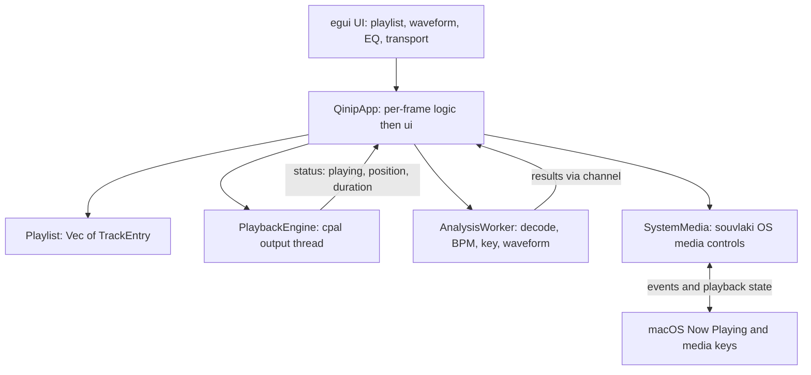
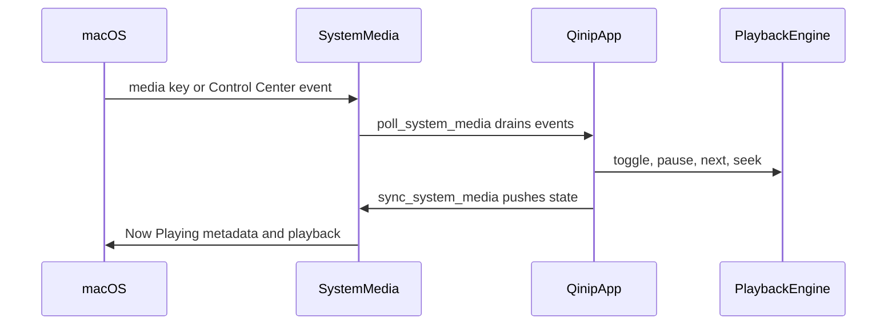

<!--
  PROJECT.md — the cockpit for this repo. One file to open and know where things stand.
  Maintained by the `project-map` skill. The assessment (status/issues/roadmap) is
  refreshed each session; the Diary at the bottom only grows. App-code changes need a
  green light; the working branch is merged only when sure.
  Keep the section order and headings identical across every project.
-->
<!-- clickup_list:1200240000009527 -->

# Qinip — cockpit

**What it is** · Free MP3 pack-audition player for macOS/Windows: playlist, coloured 4-band waveform, EQ knobs, background BPM/key/Camelot analysis, gapless autoplay.
**Stack** · Rust, egui/eframe (immediate-mode GUI), cpal (audio out), symphonia (MP3 decode), rustfft (Qinip's own tempo + key detection), souvlaki (OS media controls), id3 (tag read/write), egui_kittest (headless UI tests).
**Status** · 🟡 v1.1.0 is built and published (dmg + zip, installer + zip, checksums, changelog on the page), **but the GitHub repo is still private, so nobody can download it**: every release link 404s for the public. One decision unblocks the launch: make the repo public (history scanned clean apart from the ZHU test MP3). `master` = the release, work continues on `feat/1.2`. Still unverified by a human: the Windows installer on a real PC, media keys in the bundle.
**Repo** · git@github.com:Hersh3yy/qinip.git · working on `feat/2.0-rune` (merge to `master` only when sure; releases only via `release.sh` / the Cut release button). Released: 1.1.0; `Cargo.toml` stays 1.1.0 until the next cut.
**Hosting** · Desktop app. Distributed as GitHub Releases (`Qinip.app` zip for macOS arm64, `Qinip.exe` zip for Windows x64).
**ClickUp** · not linked
**Last assessed** · 2026-11-17

---

## Run it

```bash
cargo run --release
```

- `--release` matters: analysis is ~18x faster than debug. Dev logging: `QINIP_DEV=1 cargo run --release`.
- See the UI without a window: `QINIP_UI_RENDER_DIR=/tmp/qinip-ui cargo test --release --lib ui_tests` writes a PNG per screen and theme (`src/ui_tests.rs`, egui_kittest; `QINIP_UI_FOLDER=<folder>` loads real tracks).
- Needs Rust 1.95+ (egui 0.36). `cargo run` is a bare binary, not the `.app`: media keys and the Dock icon behave differently; test those in the bundle (`bash scripts/package-macos.sh`).
- Regenerate third-party licenses after dependency changes: `cargo about generate -c scripts/licenses/about.toml scripts/licenses/about.hbs > assets/THIRD_PARTY_LICENSES.html` (`cargo install cargo-about --locked --features cli` once).

### Picking up on another laptop

```bash
git clone git@github.com:Hersh3yy/qinip.git && cd qinip && git checkout feat/1.2 && rustup update stable && cargo run --release
```

Already cloned: `git fetch && git checkout feat/1.2 && git pull`. Read this file's Status, Issues and the newest Diary entry first; the first open roadmap item is the one to do.

### Developer setup, Mac

1. `xcode-select --install` (the C compiler and libclang that aubio's build needs).
2. Install Rust: `curl https://sh.rustup.rs -sSf | sh`, then `rustup update stable`.
3. `git clone git@github.com:Hersh3yy/qinip.git && cd qinip && cargo run --release`.
4. Try it as users get it: `bash scripts/package-macos.sh`, then `cp -R target/release/bundle/osx/Qinip.app ~/Applications/`.

### Developer setup, Windows

1. Install **Visual Studio Build Tools** with the "Desktop development with C++" workload (Rust's MSVC linker needs it): `winget install Microsoft.VisualStudio.2022.BuildTools`, then tick that workload in the installer. No LLVM or C libraries anymore (aubio is gone since 1.1.0).
2. Install **Rust** from rustup.rs (`rustup-init.exe`, default MSVC toolchain) and **Git** (`winget install Git.Git`).
3. In Git Bash: `git clone https://github.com/Hersh3yy/qinip.git && cd qinip && cargo run --release`.
4. Package: `bash scripts/package-windows.sh` → `target/release/qinip-windows-x64.zip`.
5. No Windows machine? GitHub → Actions → Release → **Run workflow** on your branch builds the Windows zip as a downloadable artifact without publishing anything. From a Mac, `rustup target add x86_64-pc-windows-msvc && cargo check --target x86_64-pc-windows-msvc` at least proves it compiles.

### Branches and releases (the rules)

Plain-words version, with the why and the launch checklist: `docs/releasing.md`.

- `master` is always releasable. Work happens on a branch (`feat/...`, `fix/...`); merge into `master` only when it's tested in the bundle.
- Every user-visible change adds a line under `## [Unreleased]` in `CHANGELOG.md`, in the same commit.
- CI (`.github/workflows/ci.yml`) runs tests + strict clippy on every push to `master` and every pull request.
- A release is cut once in a while, only from `master`, only with `./scripts/release.sh X.Y.Z` (try `--dry-run` first). It checks branch, clean tree, version, changelog, tests; moves Unreleased into the version; bumps `Cargo.toml`; commits and tags; asks before pushing.
- The pushed tag starts `release.yml`: it refuses a tag that doesn't match `Cargo.toml` or has no changelog section, builds Mac (dmg + zip) + Windows (installer + zip), and publishes the GitHub release with that changelog section and download/"Open Anyway" instructions. Nothing else ever creates a release.
- No terminal needed: Actions → **Cut release** (`.github/workflows/cut-release.yml`) runs `release.sh` on `master` with `--yes` and then starts `release.yml` on the tag (a tag pushed by GITHUB_TOKEN does not trigger workflows by itself). "Only check" = dry run.
- Version numbers: bug fixes only = patch (1.1.1), new features = minor (1.2.0), breaking saved data/behaviour = major (2.0.0).

## Status

v1.0.0 is the last public release (2026-07-21). Everything since is on `feat/multiselect-folders-media`, merged with `master` (Hiren's Clear Playlist + move dialog), listed under Unreleased in `CHANGELOG.md`, and ready for `./scripts/release.sh 1.1.0`. This session's audit-driven pass fixed the launch blockers (see Diary 2026-11-05), replaced aubio with Qinip's own tempogram (BPM within 0.1 of tags on all six test tracks; the beat phase drives the tempo light and loop snapping), reads BPM/key from file tags, added Red/Forest Green themes, and added headless UI tests that render every theme. Still unverified by a human: the Windows zip (it cross-compiles), media keys in the bundle. Licence stays GPL-3.0-or-later; with aubio gone it is now a choice, not an obligation.

## Issues

| Sev | Issue | Where |
|---|---|---|
| release-blocker | The repository is **private**, so the v1.1.0 release page and `releases/latest/download/...` links return 404 to everyone but Hiren. Options: make it public now; scrub the ZHU MP3 from history first (filter-repo + force push + re-tag), then public; or stay private and host the files on itch.io / the website. Hiren's call; nothing else is in the way. | GitHub settings, `README.md` links, `docs/launch/instagram-post.md` |
| warning | The **Cut release** button (`cut-release.yml`) has never run. v1.1.0 was cut from the terminal. Try it once with "Only check" before relying on it. | `.github/workflows/cut-release.yml` |
| serious | No human has run the Windows build. It cross-compiles and the launch crash (souvlaki needing an HWND) is fixed by passing the window handle, but media keys and the whole UI are untested there. | `src/app.rs` (`init_system_media`), CI Windows job |
| serious | Mac builds are ad-hoc signed: users get the "Open Anyway" dance once. Needs the paid Apple Developer account or a sponsor. | `scripts/package-macos.sh` |
| warning | `playing_track` / `confirm_delete` are raw indices hand-shifted on remove and cleared on sort; a `TrackId` would delete that code. | `src/app.rs` (`remove_from_playlist`) |
| warning | Resampling runs on the UI thread on Load when device rate ≠ file rate (44.1 vs 48 kHz). Tens of ms stall per track. | `src/playback.rs` (`resolve_track_samples`) |
| warning | A single big `app.rs` (~2,900 lines) holds state, logic and all drawing. | `src/app.rs` |
| note | Worker polls with a 20 ms sleep instead of blocking on `recv()`. | `src/worker.rs` |
| note | souvlaki pulls `block 0.1.6` (future-incompat warning). symphonia 0.6 and egui 0.37 held back (breaking). | `Cargo.lock` |
| note | Drum & bass reads at half tempo (87 for a 174 track): the 2-beat lag is the stronger autocorrelation peak and the DJ-tempo prior agrees. A ×2 button or genre-aware range would fix it. | `src/bpm.rs` (`prior`) |

## Guide

Immediate-mode GUI: `eframe::App` for `QinipApp` runs every frame as `logic()` (state: poll audio, worker, media, keyboard, autoplay) then `ui()` (draw). Entry is `src/main.rs` → `QinipApp::new` (`src/app.rs:102`).

The pieces:
- **Playlist model** (`src/playlist.rs`): `Playlist { tracks: Vec<TrackEntry> }`. `TrackEntry` holds path, tags, analysis state, `load_order` (to restore the unsorted view), `source_folder` (which Load Folder / drop it came from; drives the group headers), and listen tracking (`listened_secs`, `played` at 20s). `append_folder`/`append_paths` walk MP3s, skip dupes, keep insertion order.
- **Selection** (`src/selection.rs`): `Selection { anchor, set }`. The anchor is what single-row actions (Enter, waveform, transport) act on; the set is what Backspace removes. `remap` carries it across a sort, `after_remove` across a removal. Unit-tested.
- **Playback** (`src/playback.rs`, `src/transport.rs`): a cpal output callback reads the shared track buffer (no allocation on the audio thread); `PlaybackEngine::status()` is the UI's read model (playing?, position, duration). EQ applied in the audio path. `silent()` is the no-device fallback.
- **Analysis** (`src/worker.rs`, `src/bpm.rs`, `src/key.rs`, `src/tags.rs`, `src/decode.rs`, `src/eq.rs`): tags first (`read_analysis_tags`: TBPM/TKEY in any common notation); the worker decodes and builds the per-band waveform off the UI thread; a thread per track runs the tempogram (`bpm.rs`: onset envelope → autocorrelation → comb-filter phase) and chroma key detection (`key.rs`), results arrive over channels and merge into the `TrackEntry` without overwriting tagged values. Decoded audio is pruned to the playing + upcoming tracks.
- **OS media** (`src/media.rs`, NEW): souvlaki `MediaControls`; `poll_system_media` (`src/app.rs:703`) drains events (Play/Pause/Toggle/Next/Prev/Seek) into engine calls; `sync_system_media` pushes title/artist/position/state back to Now Playing each frame while playing.
- **Domain words**: *Camelot* = harmonic-mixing wheel code (e.g. 8A) derived from musical key. *Played* = a track that got ≥20s of actual playback (gates the autoplay chain). *load_order* = original append order, used as the "no sort" view.

**Architecture — what flows between the modules:**



**System play/pause round-trip (the thing being debugged this session):**



**Explainer deck:** "Qinip for Nami", 15 slides for a non-programmer (journey of a song, sound as numbers, the four bands, beat and key with the real figures from the test track, mistakes fixed, release, roadmap): https://claude.ai/artifact/SrzZvf3F7X8Mg1zLWs21Qq (private until shared). Source slides in `docs/qinip-for-nami/project/`; images there point at the artifact's uploaded assets, so they only render inside the artifact.

## Hard parts

### OS media keys route to the bundled app, not the binary

🔭 **What it does** — souvlaki talks to macOS `MPRemoteCommandCenter` / `MPNowPlayingInfoCenter`. The OS decides which app owns the media keys and the Control Center transport by which registered app last published a non-stopped Now Playing state. A raw `cargo run` binary is not a Launch Services app, so the OS keeps routing keys to Music.app and never to Qinip.

⚖️ **Why this way** — Apple deliberately centralises transport control; there is no "grab the F8 key" API for a plain executable. Registering through the media-remote framework from inside a bundle is the sanctioned path.

🗣️ **Say it to a senior** — "Media keys are owned by the system's now-playing coordinator, so the fix isn't in our key handling, it's making sure we register as a proper bundled now-playing app and publish playback state."

### Tempo from autocorrelation, not from a beat tracker

🔭 **What it does** — `bpm.rs` turns the track into an onset-strength envelope (how much louder each frequency band got since the previous 6 ms frame, with the slow level changes subtracted) and correlates that envelope with a delayed copy of itself. The delay at which it matches itself best is the beat period; a parabola through the three points around that peak gives the period to a fraction of a frame, which is why the result lands within 0.1 BPM of the tags. A comb filter (sum the envelope at `phase + k·period` for every phase) then finds where the beats fall, which the tempo light and the loop buttons use.

⚖️ **Why this way** — aubio's beat tracker was tried first and read 1.5–2.4 % high on every tagged test track: its running period drifts and periodically re-syncs, and no averaging of its beats undoes that. The autocorrelation looks at the whole track at once and has no tracking state to drift. Dropping aubio also removed the only C dependency (and the GPL obligation).

🗣️ **Say it to a senior** — "We don't track beats, we measure the period: autocorrelate the onset envelope, pick the peak in the 70–180 BPM window, refine it with a parabola, then recover the phase with a comb filter."

### Batch removal has to run high index to low

🔭 **What it does** — Tracks live in a `Vec`, so removing index `i` shifts every later index down by one. Deleting a multi-selection by ascending index corrupts the rest of the selection. Removing in descending order keeps the not-yet-removed indices valid.

🗣️ **Say it to a senior** — "When you delete several rows from a vector-backed list in one pass, you remove from the bottom up so the surviving indices don't shift under you."

### Folder separators only make sense in load-order view

🔭 **What it does** — A "this track came from folder X" grouping is only meaningful while the list is in append order. The moment the user sorts by BPM/Artist/etc., rows from different folders interleave and any separator becomes noise. So folder grouping has to be conditional on `playlist_sort == None`.

🗣️ **Say it to a senior** — "Grouping and sorting are mutually exclusive views of the same list, so the folder separators render only in the unsorted view."

## Roadmap — near future

v1.1.0 is published but invisible (private repo). First item unblocks everything else.

- [ ] Decide and do: make the repo public (or scrub the ZHU MP3 first, or host the downloads elsewhere). Then re-test the four `releases/latest/download/` links in a private browser window; they must redirect, not 404. <!-- id:p14 cu:123kjkdqc95 -->
- [ ] Test the Cut release button once: Actions → Cut release → version `1.1.1` → tick "Only check". It must end green without committing anything. <!-- id:p15 cu:123kjkdqc96 -->
- [ ] Post: `docs/launch/instagram-post.md`, after p14 and after downloading the dmg yourself in Safari. <!-- id:p16 cu:123kjkdqc97 -->
- [x] 2.0 spike: Qinip's screen rebuilt on Rune as `rune-ui/` (own workspace, binary `qinip-rune`, pinned dev rev 3d037b4). Parts a–e work, verified headless. Verdict: stay on egui for shipping; Rune is the 2.0 candidate once it settles (see `rune-ui/README.md`). <!-- id:p17 -->
- [ ] 1.2 / 1.3 features: collected by Hiren while using 1.1.0 this week; add here as they come. <!-- id:p18 -->

- [ ] Verify system play/pause in the packaged `Qinip.app` (media keys, Control Center, Bluetooth headphone button). If it fails there too, dig into souvlaki registration. <!-- id:n1 cu:123kjkdmpx9 -->
- [x] Multi-select + batch delete (Shift/Cmd click, Cmd+A, Esc, Backspace removes the set high→low). <!-- id:n2 cu:123kjkdmpxa -->
- [x] Folder group headers in load-order view, driven by `TrackEntry::source_folder`. <!-- id:n3 cu:123kjkdmpxb -->
- [x] Multi-folder / folder+file drop loads everything. <!-- id:n4 cu:123kjkdmpxd -->
- [x] Feature branch + WIP committed as a fallback point. <!-- id:n5 cu:123kjkdmpxe -->
- [ ] Hiren test-drives the new selection UX and folder headers in the bundle; adjust by feel. <!-- id:n6 cu:123kjkdmpxf -->
- [x] Release pipeline: `package-macos.sh` does Developer ID + hardened runtime + notarize + staple + dmg when `SIGN_IDENTITY` / `NOTARY_PROFILE` are set, ad-hoc otherwise; empty `scripts/qinip.entitlements`. <!-- id:r1 cu:123kjkdmpxg -->
- [x] CI: `release.yml` imports the cert and notary key from secrets when present, uploads dmg + zip. <!-- id:r2 cu:123kjkdmpxh -->
- [ ] Hiren: enroll Apple Developer Program, make the Developer ID Application cert, `notarytool store-credentials`, run the script once with both vars, then add the 6 GitHub secrets. <!-- id:r1b cu:123kjkdmpxj -->
- [x] No startup panic without audio output: silent engine + "Retry audio" banner; media controls optional. <!-- id:r3 cu:123kjkdmpxk -->
- [x] `move_to_folder` uses `file_ops::move_file` (copy-then-remove fallback across volumes, tested). <!-- id:r4 cu:123kjkdmpxm -->
- [ ] `TrackId` identity for `playing_track` / `confirm_delete`; delete the index-shifting code. <!-- id:r6 cu:123kjkdmpxn -->
- [ ] Unit tests for `remove_from_playlist`, `compare_tracks`, `resample_interleaved` (tempo, keys, tags, EQ and the UI now have tests). <!-- id:r7 cu:123kjkdmpxp -->
- [ ] A human runs the Windows 1.1.0 zip: launch, play, media keys, themes. Until then the download page calls Windows "beta". <!-- id:p12 cu:123kjkdqc98 -->
- [ ] Decide the licence: aubio (the GPL reason) is gone, so MIT/Apache is possible. Hiren's call; GPL stays until then. <!-- id:p13 cu:123kjkdqc99 -->
- [x] GPL-3.0-or-later LICENSE, About window, `THIRD_PARTY_LICENSES.html` via cargo-about, shipped in the bundle and Windows zip. <!-- id:p1 cu:123kjkdmpxq -->
- [x] Auto tag-writing is opt-in (off by default); settings persist via eframe storage. <!-- id:p2 cu:123kjkdmpxr -->
- [x] Transport button and Bar readout clipping fixed; volume fader + mute next to transport. <!-- id:p3 cu:123kjkdmpxt -->
- [x] Hiren checks the new transport row, volume fader and About window by eye. <!-- id:p4 cu:123kjkdmpxu -->
- [x] CHANGELOG.md (keepachangelog) + bump to 1.1.0 for the first public release. <!-- id:p5 cu:123kjkdmpxv -->
  CHANGELOG.md, `scripts/release.sh`, CI checks and tag verification are in; what's left is merging to `master` and running `./scripts/release.sh 1.1.0`.
- [ ] "New version available" check: fetch `latest.json` from Hiren's site on launch, dismissable banner, off-switch, privacy note updated. <!-- id:p6 cu:123kjkdmpxw -->
- [ ] Download page on Hiren's site: per-OS buttons, version, size, SHA-256, min OS, changelog, uninstall steps, license + source link. <!-- id:p7 cu:123kjkdmpxx -->
- [x] Windows: real installer + uninstaller (prototype Velopack), OV Authenticode cert, test on a real Windows machine. <!-- id:p8 cu:123kjkdmpxy -->
  Installer done with Inno Setup (`scripts/windows/qinip.iss`, CI builds `qinip-setup-x64.exe`; exe icon via `build.rs` + winresource). Velopack (auto-update) and the cert remain.
- [x] Shuffle + repeat (off/all/one) in the transport; rules unit-tested. <!-- id:p9 cu:123kjkdpukz -->
- [x] Themes: Match system, Dark, Light, Solarized Dark, Solarized Light; palette contrast tested. <!-- id:p10 cu:123kjkdpum0 -->
- [x] Stable release asset names (`qinip-macos-arm64.dmg/.zip`, `qinip-windows-x64.zip`) + `SHA256SUMS.txt` from CI, so the website links `releases/latest/download/<name>` forever. <!-- id:p11 cu:123kjkdpum1 -->

## Roadmap — far future

- [ ] Resampling off the UI thread, or cache per device rate. <!-- id:r8 cu:123kjkdmpxz -->
- [ ] Worker blocks on `recv()` instead of a 20 ms sleep. <!-- id:r9 cu:123kjkdmpy0 -->
- [ ] Split the god object: `playlist_view.rs`, `transport_view.rs`, `theme.rs`, `analysis.rs`, and a `PlaylistAction` enum (name the Command pattern already in use). <!-- id:r10 cu:123kjkdmpy1 -->
- [ ] Windows: Authenticode signing (OV cert, e.g. Certum) + verify souvlaki with a real `hwnd`. <!-- id:f1 cu:123kjkdmpy2 -->
- [ ] Persist playlist / session between launches. <!-- id:f2 cu:123kjkdmpy3 -->
- [ ] Non-MP3 formats (FLAC/WAV/AAC) via symphonia's other decoders. <!-- id:f3 cu:123kjkdmpy4 -->
- [x] Package-currency pass: `cargo update` (patch/minor), egui/eframe 0.36, Rust 1.99, clippy auto-fixes. <!-- id:f4 cu:123kjkdmpy5 -->
- [ ] symphonia 0.5 to 0.6: breaking decode API; do it after release, behind the decode tests. <!-- id:f5 cu:123kjkdmpy6 -->
- [ ] souvlaki 0.8.3 pulls `block 0.1.6` (old `cocoa`), which a future Rust will reject. Watch for a souvlaki release or patch it. <!-- id:f6 cu:123kjkdmpy7 -->
- [ ] Bar counter / metronome on the beat grid: period and phase exist now (`bpm.rs`), the tempo light and loops use them; what's missing is the downbeat (which beat is 1), e.g. the phase among the four whose beats carry the most Low-band energy, plus a "set beat 1 here" nudge. Then a 1-2-3-4 readout and a click track. <!-- id:f7 cu:123kjkdmpy8 -->
  Plan: (1) keep aubio's per-beat times during analysis, not just the BPM; (2) refine BPM with a line fit through them, grid phase = circular mean of beat-time mod period; (3) guess the downbeat as the phase whose beats carry the most Low-band energy (kick on the 1); (4) a "set beat 1 here" nudge for when the guess is wrong, like Rekordbox's grid adjust; (5) counter and loop buttons snap to the grid; (6) metronome = a click mixed in the audio callback at grid times. About two sessions.
- [x] Rekordbox bridge via rekordbox XML, the import format Pioneer documents and Rekordbox 6/7 read. Qinip keeps its own playlists and writes them to one XML file; right-click → "Add to Rekordbox playlist ▸ <name> / New…". One-time Rekordbox setup (Preferences > Advanced > Database > rekordbox xml; show "rekordbox xml" in the tree), then refresh + Import in Rekordbox. Not writing Rekordbox's own `master.db` (encrypted, undocumented, can corrupt the library). Check against Hiren's Rekordbox version first. <!-- id:f9 cu:123kjkdpum2 -->
- [ ] Revisit Rune for 2.0: re-run the `rune-ui/` spike against a newer rev (or the first crates.io release); go if the weekly breaking changes have stopped and the kit has sliders/knobs. Porting list is in `rune-ui/README.md` ("Not ported"). <!-- id:f10 -->
- [ ] Velopack auto-update (replaces the p6 banner with in-app updates). <!-- id:f8 cu:123kjkdmpy9 -->

---

## Diary

<!-- Newest first. One entry per working session. Terse, factual, honest. Append only. -->

### 2026-11-17 — branch for 2.0 on Rune
- `feat/2.0-rune` branched from `feat/1.2`, which is deleted (local + origin); one working branch. Released version stays 1.1.0.
- Rune spike built by an agent in one session: `rune-ui/` with top bar, virtualised table, four-band waveform canvas, transport, tempo light, volume, file drop, theme menu; every part verified with Rune's headless `--snap`/`--tree`/`--script` (file dialog, drop and menu picks scripted, which egui_kittest cannot do). Two bugs found only by looking at the PNGs: Rune colours are linear light (palette needed sRGB decoding) and a flex table collapses to 0 pt without `grow + min_h(0)`. Clean release build 174 s / 296 crates; warm 19 s; binary 31.9 MB vs 19.8 MB.
- The agent had wired the spike as a workspace member with a root `[patch.crates-io]` table, which silently swapped the shipped egui app's winit for Rune's fork. Undone: root `Cargo.toml`/`Cargo.lock` restored, `rune-ui/` made its own workspace (own lock, own patch table), root excludes it. Toolchain now 1.100.
- Verdict recorded in `rune-ui/README.md`: stay on egui; revisit (f10) when Rune is on crates.io or its churn stops.
- ClickUp: every linked koala project now has task ids for all items; `scripts/clickup-sync-all.sh` in the project-map skill syncs all eight; the token comes from `hiren-ninja/.env`.

### 2026-11-14 — hand-off to the laptop; the repo is private
- After the 2026-11-12 release: the public links 404. Cause found: the GitHub repository is **private** (it always was; the README and the IG post assumed public). The release itself is fine (`v1.1.0` marked latest, 5 assets, notes render). Full history scanned for secrets, private paths and emails: clean; only the ZHU MP3 (9.8 MB, commit 0d656df) is in history. Hiren interrupted the go-public question; it is now roadmap p14, his decision.
- Branch hygiene: `feat/multiselect-folders-media` is fully merged into `master` (fast-forward) and deleted locally and on origin. One working branch: `feat/1.2`. No unpushed commits anywhere.
- No ClickUp sync (no `CLICKUP_API_KEY` in this session); new ids p14–p16 need one run.
- Not done: nothing in the app changed this session.

### 2026-11-12 — v1.1.0 released; installer, Cut-release button, feat/1.2
- Windows installer: `scripts/windows/qinip.iss` (Inno Setup, per-user, Start menu, uninstaller) built by CI; exe icon via `build.rs` + winresource (`assets/qinip.ico` generated from the app icon). First CI run failed twice: `macos-14` runner label retired (now `macos-latest`), and Git Bash rewrote `/DAppVersion=` into a drive path (installer step now runs in PowerShell). Test dispatch on the branch: both jobs green.
- `.github/workflows/cut-release.yml`: Actions → Cut release → version; runs `release.sh --yes` on master and dispatches the tag build (a GITHUB_TOKEN tag push does not trigger workflows). Not yet exercised for real; v1.1.0 was cut with `release.sh` from the terminal.
- README: per-OS install guide (dmg, installer, portable; first-launch warnings, update, uninstall, checksum). `docs/releasing.md`: the release protocol in plain words.
- Release: local `master` had an unpushed `icon` commit diverging from origin's Clear Playlist commit; reset local master to origin, fast-forwarded to the branch tip (which contained both). `release.sh` had no exec bit in git (fixed). Then dry run, real run, tag build 43184533774 green, page published with dmg (9.8 MB), zip, setup exe (8.1 MB), portable zip, SHA256SUMS.
- `feat/1.2` branched from master for what comes next. ZHU MP3 stays in history by Hiren's decision (free project).

### 2026-11-05 — launch prep: audit, tempogram, themes, UI tests
- Merged `master` (Hiren's Clear Playlist + move dialog, ported by hand onto the branch; a moved track now leaves the playlist). Untracked the copyrighted test MP3 (`test_audio_files/*.mp3` gitignored; still in git history, see hand-off).
- Adversarial audit (agent) found: Windows launch crash (souvlaki `hwnd: None`), low-sample-rate crash in `eq.rs`, shortcuts firing inside the playlist-name field, tag write wiping unparsable tags, unbounded `audio_cache`, README leftover table, stale autoplay hijack, shuffle not resetting, load-while-sorted, Clear leaving a ghost track, short tracks never "played". All fixed; `window_hwnd()` passes the Win32 handle, `#![windows_subsystem]` set, `cargo check --target x86_64-pc-windows-msvc` passes.
- BPM: aubio's beat tracker read 1.5–2.4 % high on all six tagged tracks even with a median of its beats; replaced with an autocorrelation tempogram (`bpm.rs`, no aubio, no C deps): 120.06/120.06/127.91/123.02/118.09/120.04 vs tags 120/120/128/123/118/120. Beat phase feeds the tempo light (replaces the drifting 1-2-3-4 counter) and loop snapping.
- Tags: `read_analysis_tags` (TBPM any format; TKEY as Am/A#m/Bbm/A Minor/8A) fills BPM/key at load → tagged libraries skip analysis; `TKEY` now written short (`Am`), file's ID3 version kept. Right-click Re-analyze. Tooltips show the source.
- Themes Red + Forest Green; `strong()` text was invisible in dark themes (egui's active text colour was the on-accent colour), fixed; grid overflowed by the 8 resize handles, fixed.
- `src/ui_tests.rs`: egui_kittest drives the real app headless (silent engine): empty state, load a folder, wait for analysis, play, every theme, About, Clear. With `QINIP_UI_RENDER_DIR` it writes PNGs, which is how the themes were checked by eye this session.
- Deps: `cargo update` (73 crates), aubio-rs and ringbuf removed, raw-window-handle added (Windows); licences regenerated. egui 0.37 and symphonia 0.6 held back.
- Release flow: `release.sh` clippy now blocking and `--all-targets`; `--locked` builds; Windows CI no longer installs LLVM. README/CHANGELOG/About updated.

### 2026-10-15 (later) — rekordbox bridge, strict release flow
- `src/rekordbox.rs`: crates (Qinip playlists) persisted in settings and exported as rekordbox XML (COLLECTION + ROOT > "Qinip" folder > playlists, KeyType 0). Writes to rekordbox's own `bridgeImportedLibraryFile` (read from `~/Library/Application Support/Pioneer/rekordbox6/rekordbox3.settings`, confirmed on Hiren's rekordbox 7.1.3) when that file is missing or Qinip's, else `~/Music/Qinip/qinip-rekordbox.xml`; never another tool's file, never rekordbox settings or master.db. Atomic write. 6 tests.
- UI: right-click → Add (N selected) to Rekordbox playlist ▸ existing / New playlist…; Rekordbox window with a live setup checklist (installed, file, "rekordbox xml" list visible via `showRbXml`), Open rekordbox, per-import steps, crate list. Paths checked against the rekordbox 7.2.3 manual by a research agent: Advanced > Database > rekordbox xml > Imported Library; View > Layout > Media Browser > rekordbox xml; refresh icon; Import Playlist; re-import duplicates; Import To Collection for BPM/key on existing tracks. Not confirmed: Tonality notation (we write "Am"/"C#").
- Release flow: CHANGELOG.md (Unreleased holds everything since 1.0.0), `scripts/release.sh` (checks + bump + tag, asks before push; changelog/version rewrite tested on copies), `ci.yml` (tests + clippy -D warnings), `release.yml` verifies tag vs Cargo.toml + changelog and publishes the changelog section as notes. Un-notarized Mac dmg now carries "If macOS blocks Qinip.txt". Fixed the last clippy warnings so strict CI starts green.
- Not done: an actual import into rekordbox by a human; first CI run on GitHub.

### 2026-10-15 — shuffle/repeat, themes, release naming
- Shuffle + repeat (off/all/one) as transport buttons. `next_candidates()` holds the rules (4 tests); `upcoming` remembers the chosen next track by path so gapless preload and advance agree, forgotten (preload dropped via new `PlaybackEngine::clear_queued`) on shuffle/repeat change, sort, load, removal. Shuffle history drives Previous. Persisted.
- `src/theme.rs`: ThemeChoice + Palette; ~30 hardcoded colours in `app.rs` and the Bar widget now read the palette. Waveform stays a dark screen, knobs/buttons stay hardware. Contrast test covers every theme. Theme picker in the top bar, persisted.
- Release: stable asset names + SHA256SUMS in CI. Rekordbox XML bridge (f9) and beat-grid plan (f7) written up, not built.
- Tests 11/11. Packaged, installed, launched. Light/Solarized themes not looked at by a human yet.

### 2026-10-14 — Nami explainer deck, push
- Measured the test track with `cargo run --release --bin analyze`: 255.1 s, 44,100 Hz stereo, 22,498,560 samples; bands Low 63.2 % / LowMid 16.7 % / HiMid 9.7 % / Hi 10.3 %; 121.9 BPM (aubio confidence 0.26); A minor (correlation 0.772) = 8A. These are the numbers used in the deck.
- Built "Qinip for Nami" (Slides artifact, 15 slides, speaker notes with a question per slide). Source kept in `docs/qinip-for-nami/`.
- Pushed `feat/multiselect-folders-media` to origin so work can continue on the other laptop. Not merged to `master`.

### 2026-10-05 — license, opt-in tag writes, deps, transport UI
- Licensed GPL-3.0-or-later (aubio is GPL-3.0 and statically compiled in). LICENSE, Cargo metadata, About window, `THIRD_PARTY_LICENSES.html` (cargo-about config in `scripts/licenses/`), both shipped in the .app Resources and the Windows zip.
- Auto tag-writing after analysis is now opt-in, off by default (`spawn_analysis` was silently editing users' MP3s). Toggle in the top bar. Settings struct persisted with eframe `persistence` (volume, autoplay, tag opt-in).
- Deps: `cargo update` patch/minor; Rust 1.93 to 1.99; egui/eframe 0.35 to 0.36 (one fix: `DroppedFile::path()` is a method now); clippy `--fix`. Held back: symphonia 0.6 (breaking, f5). souvlaki drags in `block 0.1.6` future-incompat (f6).
- Transport: buttons were clipped because the glow ring sat outside the 40px rect; now 36px with the cap sized to leave room for the ring. Bar readout BPM text was drawn below its rect; rect made taller. Volume moved from the bottom bar to a fader + mute next to transport.
- Metronome / beat-synced bar counter parked as f7 (next phase; needs a beat grid).
- Tests 6/6, release build clean, packaged, installed and launched. Could not screenshot the window from the session (no screen-recording permission), so the visual result is unverified by me.

### 2026-09-28 — release pipeline, crash-proofing
- r3: `PlaybackEngine::silent()` + `has_output()`; `play()` refuses in silent mode. App starts with a "Retry audio" banner instead of panicking; `SystemMedia` is now `Option`.
- r4: `file_ops::move_file` (rename, then copy + size check + remove on `CrossesDevices`; copy is rolled back if the original can't be removed). 2 tests. Not exercised on a real second volume, unit tests only.
- r1/r2: rewrote `scripts/package-macos.sh` (Developer ID + hardened runtime + notarytool + stapler + spctl when env vars set; ad-hoc fallback; dmg with Applications link; version/build number from Cargo.toml and commit count; `MACOSX_DEPLOYMENT_TARGET=11.0`). Added empty `scripts/qinip.entitlements`. CI imports cert/notary key from secrets when present.
- Fixed a latent CI break: Windows job copied the deleted `USER_MANUAL.md`.
- `cargo test` 6/6. Built, installed to `~/Applications`, launched; process stays up. No Developer ID identity on this Mac yet, so still ad-hoc.

### 2026-09-22 (later) — built the three features, release audit
- Green light received. Branch `feat/multiselect-folders-media` off `master`; committed the pre-existing souvlaki/transport WIP as `ab1bbe6` (fallback point), untracked `.DS_Store`.
- New `src/selection.rs` (anchor + set, 3 unit tests). `app.rs`: `selected: Option<usize>` replaced by `Selection`; plain/Shift/Cmd click, Cmd+A, Esc, Backspace removes the set high→low; multi-selected rows get an amber wash, anchor keeps the white outline. Selection survives sort via `remap` by path.
- `playlist.rs`: `TrackEntry::source_folder`, `append_with_source`, `distinct_source_count`. Group header rows (📁 name · count, hover = full path) drawn only when unsorted and >1 source. `handle_drops` now loads every folder and the loose files.
- Ran the read-only release/quality audit (agent) → `docs/release-and-code-quality.md`; roadmap items r1..r10 added. Headline: the build is ad-hoc signed; trustworthy release needs Developer ID + notarytool + stapler.
- Docs: `USER_MANUAL.md` folded into `README.md` and deleted; PROJECT.md gained two Mermaid diagrams (render-verified). Skill updated to require both.
- Built `Qinip.app` via `scripts/package-macos.sh` (release, ad-hoc). Handed to Hiren to test-drive; media keys unverified by a human.
- Not done: ClickUp link (the sandbox refused to read the token from `hiren-ninja`; Hiren runs the setup command himself).

### 2026-09-22 — first map, triaged Hiren's three asks
- Renewed: wrote this PROJECT.md. `cargo check` green on the current working tree.
- Found the working tree mid-flight: souvlaki media integration (`src/media.rs`) + macos_icon + transport rework staged but uncommitted on `master`; app.rs/tags.rs also dirty.
- Diagnosed the three asks without touching app code (green-light rule): (1) media play/pause wiring looks correct in code — prime suspect is bundle/registration, verify in the `.app` first; (2) select-all+delete needs real multi-select (currently single `Option<usize>`); (3) folder separators need a per-track source folder + conditional grouping in load-order view, and the multi-folder drop bug (only first folder loads) should be fixed alongside.
- Left red: nothing built/changed — awaiting green light on which of n1–n5 to start.
