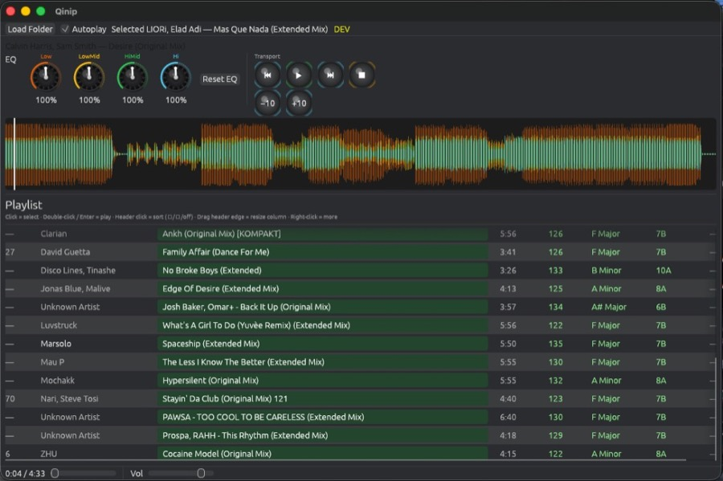

# Qinip

Free MP3 pack audition player for macOS and Windows — playlist, coloured waveform, 4-band EQ, BPM/key analysis, gapless autoplay.

Full how-to: [`USER_MANUAL.md`](./USER_MANUAL.md)

<p align="center">
  
</p>

---

## Why Qinip?

<p align="center">
  
</p>

**Qinip** is how I say *guinep* — the small Caribbean fruit that grows in bunches. You crack one open to see the juicy bit inside.

Same idea here: load a bunch of songs, crack one open, see the waveform inside. I built it because **Clementine** died on Apple Silicon and **Strawberry** wants €10/month. This one's free.

---

## Features

- Load folders of MP3s — playlist with sortable columns (BPM, key, Camelot, duration…)
- Coloured 4-band waveform + EQ knobs — see and shape what's inside each track
- BPM, musical key, and Camelot wheel codes — analyzed in the background
- Transport controls, gapless autoplay, write BPM/key back to file tags
- Right-click tracks — move, tag, open folder, remove from list, delete from disk

---

## Download

Get the latest release from **[GitHub Releases](https://github.com/Hersh3yy/qinip/releases)**:

| Platform | File | What to do |
|----------|------|------------|
| **macOS** (Apple Silicon) | `qinip-macos-arm64.zip` | Unzip → drag `Qinip.app` to Applications |
| **Windows** (x64) | `qinip-windows-x64.zip` | Unzip → run `Qinip.exe` |

**macOS first launch:** if Gatekeeper blocks the app:

```bash
xattr -cr ~/Applications/Qinip.app
```

Then right-click → Open.

**Windows:** SmartScreen may warn — More info → Run anyway (unsigned build).

---

## Support

Qinip is free — download, use, share. If it saves you time or money, tips are welcome *(donation link coming soon)*.

---

## Build from source

Requires [Rust](https://rustup.rs):

```bash
cargo run --release
```

macOS app bundle: `bash scripts/package-macos.sh` → `target/release/bundle/osx/Qinip.app`

Details for developers and contributors: see [`USER_MANUAL.md`](./USER_MANUAL.md) and the source in `src/`.
